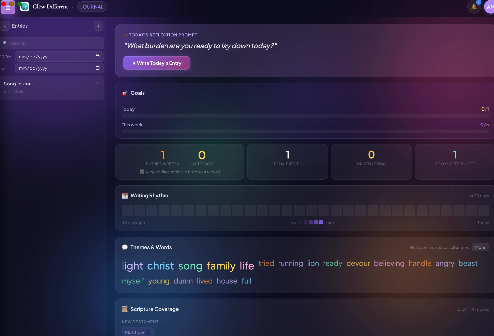

# Ministry Hub

[](https://github.com/amandammonroe101-netizen/ministry-hub/actions/workflows/ci.yml)

A cross-platform desktop application for church and ministry teams — combining day-to-day ministry
operations (people, prayer, discipleship, scheduling, communications) with a full creative production
suite (multitrack audio recording, podcast studio, setlists, stage plots) and a website/blog
management back office.

Built with **Electron + React (Vite)** on a **Firebase** backend — Authentication, Cloud Firestore,
Cloud Storage, and Cloud Functions — with offline persistence and real-time sync across windows and
devices.


*Worship Ministry → Piano. Nine Web Audio voices, octave shifting, scale highlighting, reverb, and an
envelope editor that applies live while you play.*



*Journal. Daily reflection prompt, goal tracking, a 30-day writing-rhythm heatmap, theme extraction
across all entries, and scripture coverage by book.*

---

## Scope

| | |
|---|---|
| Feature modules | 78 |
| React components | ~250 |
| Shared domain libraries | 35 |
| Platforms | macOS (dmg/zip), Windows (nsis/portable), Linux (AppImage/deb) |

Roughly grouped:

- **Chat & collaboration** — real-time public and private channels, 1:1 direct messages, invite/accept flows, file attachments, and unread badges — reachable from inside the ministry directories, so a worship or hospitality team coordinates on a project without leaving the page they're working on
- **People & care** — contacts (member search and connection requests), friends, pastoral care, visitors, outreach, missions, hospitality, discipleship
- **Support** — members file bug reports, feature requests, and add-on ideas from Settings; the owner triages them and can open a reply thread
- **Prayer & journaling** — prayer lists with status tracking, journal, testimony, daily verse and briefing
- **Planning** — calendar, day planner, scheduling, rosters, subs, meetings, countdowns, budget
- **Worship & production** — songs, setlists, CCLI tracking, multitrack recorder, stems library, mix notes, drums, stage plots, lyrics display, soundscapes
- **Media** — podcast studio, recording, scenes, editor
- **Writing** — long-form documents organized into series and folders
- **Web presence** — blog (posts, series, authors, comments, newsletters, ideas, quotes, performance), site pages, forms, SEO health, tech stack, issue tracking
- **Administration** — roles and permissions, inventory, maintenance, update log, style guide, settings

---

## Project status

This is an active, in-progress build, not a finished product. Being specific about where the line
sits:

**Working**

- Worship & production — the Web Audio multitrack recorder, instruments, and the piano
- Chat — channels, direct messages, invites, attachments, unread badges
- Contacts — member search, connection requests, consent-gated info sharing
- Support requests from Settings, with owner triage and reply threads
- Journal, prayer, testimony, daily verse and briefing
- Writing — long-form documents, series, and folders
- Auth, role-gated routing, Firestore sync, offline persistence, multi-window sync
- Packaged builds and auto-update on all three platforms

**In progress**

- Page design is inconsistent across the ministry modules — each one was built as its own
  surface and they have not yet been unified behind a shared layout and component set
- Some personal-user features are broken and under repair
- Test coverage starts at the security rules and stops there — the rules are tested against the
  emulator in CI, the application code is not tested yet

The 78 modules are at uneven depth by design — breadth came first to find out which parts a
ministry team actually reaches for, and the surfaces that got used are the ones that got finished.

---

## Architecture

```
ministry-hub/
├── electron/
│   ├── main.js            Main process — windows, auto-update, native menus
│   └── preload.js         Context bridge (contextIsolation enabled)
├── client/                React + Vite renderer
│   └── src/
│       ├── pages/         78 feature modules, one directory each
│       ├── components/    Shared UI — nav rail, onboarding, tour, profile, error boundary
│       ├── context/       AuthContext — session, role, founder/protected routing
│       ├── lib/           35 domain modules (Firestore access, audio, chat, sync, exports)
│       └── services/      Per-resource data services
├── functions/             Firebase Cloud Functions (privileged server-side operations)
├── docs/
│   ├── firestore.rules    Security rules
│   ├── storage.rules      Storage rules
│   ├── firebase-migration.md
│   └── *_HOW_TO_USE.md    Per-module user documentation
└── tools/analytics/       Local usage reporting scripts
```

### Notable engineering decisions

**Local-first → cloud sync.** The app began on an Express + SQLite backend. It was migrated to
Firestore to support multi-device sync and shared ministry teams, while keeping offline persistence
so the app stays usable without a connection. Migration notes are in
[`docs/firebase-migration.md`](docs/firebase-migration.md).

**One document per record.** Writing documents, studio projects, and similar collections are stored
one-per-Firestore-document rather than as arrays inside a parent. This keeps writes small, avoids
document size ceilings, and prevents concurrent edits in two windows from clobbering each other.

**Authorization lives in security rules, not the client.** Role gating (`ProtectedRoute`,
`FounderRoute`) is a UX affordance; actual enforcement is in
[`docs/firestore.rules`](docs/firestore.rules), so a modified client cannot read or write data it
shouldn't.

**Two consent models for chat membership.** A private channel normally requires an invite the other
person accepts, so a channel can never gain a member without that member's consent. But a "Chat"
button inside a ministry directory acts on someone you are *already* mutually connected to in
Contacts — there is nobody left to ask. `lib/directChat.js` creates those channels with both uids in
`memberUids` from the start, which is legal under the security rules because channel `create` only
requires the creator to be *a* member, not the *only* member. Both paths are enforced server-side;
neither depends on the UI hiding a button.

**One document is both the request and the relationship.** A Contacts connection lives at
`/contactRequests/{senderUid}__{recipientUid}` with a `status` of `pending` or `accepted`. Because
the id is deterministic from the pair, there is no way to end up with duplicate requests between two
people, and "decline," "cancel," and "remove connection" all collapse into deleting one document
instead of three separate code paths.

**A hidden field is absent, not merely unrendered.** `/users/{uid}` is readable by every signed-in
member — that is what makes Contacts search and chat author labels work — so "hide my email from the
directory" cannot be a rendering decision. Filtering it out client-side after the fetch protects
nothing, because anyone can read the document directly. So the value is never stored: toggling
visibility off deletes the field, and the security rules reject any write where `emailVisible` is
false while `email` is still present. Profiles written before this are reconciled on next sign-in.

**Sharing contact details is a request, not a setting.** Members can hide their email or phone from
the directory. When another member needs one — the Business Ministry order form, say — they file a
purpose-scoped `infoShareRequest` naming which fields they want and why, and the recipient accepts or
declines that specific ask. It is deliberately not a persistent relationship like a Contacts
connection: consent is granted per request, and nothing is shared without it.

**Support requests escalate asymmetrically.** Anyone can file a request from Settings, and the owner
can always reply on its thread. The *sender* cannot post back until they ask for two-way access and
the owner accepts — `twoWayStatus` moves `requested` → `accepted`, and the security rules, not the
UI, are what stop the sender's messages before that. So the owner opens a direct line only on the
requests where it is actually warranted, and a support inbox can't be turned into an unsolicited
channel to the owner.

**Unread counts span two different collections.** Chat lives in `channels/{id}/messages`, but
founder-request threads live in `founderRequests/{id}/messages`. The nav badge has to total both, so
`lib/chatUnread.js` runs separate subscriptions, starts no listeners until a user is signed in, and
tears them all down on sign-out or when the channel set changes. Read state is a per-channel
last-read timestamp in one shared `kv` key, so opening a thread clears its contribution to the badge
without any explicit bookkeeping.

**Multi-window state sync.** `WindowSync` keeps detached windows consistent with the main window, so
a setlist open on a second display reflects edits made in the primary one.

**Web Audio multitrack engine.** The recorder handles per-track arming, monitoring, and mixdown in
the renderer using the Web Audio API, with takes persisted to Cloud Storage.

**Auto-update.** Packaged builds update via `electron-updater` against GitHub Releases, with
`electron-log` for diagnostics from installed copies.

---

## Getting started

Requires Node.js 18+ and npm 9+.

```bash
npm install
cd client && npm install && cd ..
```

Create `client/.env` from the template and fill in a Firebase web app config:

```bash
cp client/.env.example client/.env
```

| Variable | |
|---|---|
| `VITE_FIREBASE_API_KEY` | Firebase web API key |
| `VITE_FIREBASE_AUTH_DOMAIN` | |
| `VITE_FIREBASE_PROJECT_ID` | |
| `VITE_FIREBASE_STORAGE_BUCKET` | |
| `VITE_FIREBASE_MESSAGING_SENDER_ID` | |
| `VITE_FIREBASE_APP_ID` | |

Run in development — starts Vite, then opens Electron once the dev server is ready:

```bash
npm run dev
```

Build installers:

```bash
npm run dist:mac      # .dmg + .zip
npm run dist:win      # NSIS installer + portable
npm run dist:linux    # AppImage + .deb
```

Output lands in `dist-electron/`.

### Tests

The security rules are tested against the Firestore emulator, so the rules file itself is what runs
— not a reimplementation of it. Requires a JDK 21+ on the path for the emulator.

```bash
npm install
npm run test:rules
```

CI runs this plus the renderer build on every push.

---

## Data & privacy

- Each user's data is scoped to their Firebase Auth account and enforced server-side by Firestore
  security rules.
- No analytics or telemetry are sent anywhere; `tools/analytics/` runs locally against your own data.
- `client/.env` is gitignored — credentials never enter version control.

---

## License

[MIT](./LICENSE)
